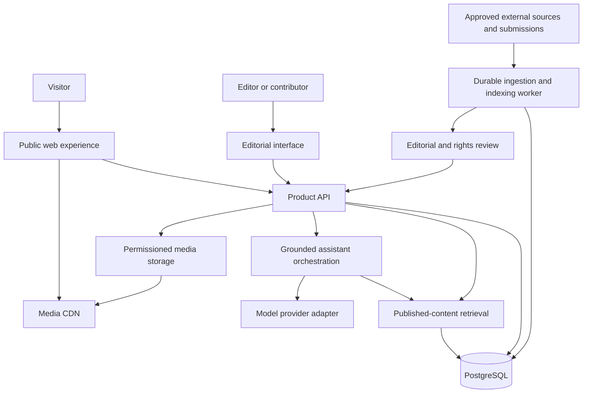

# Africa Bites

### Explore the continent through the stories carried by its food.

Africa Bites is a proposed living culinary atlas of Africa: a place to discover dishes through geography, ingredients, language, history, preparation and the people who share their knowledge.

A visitor might arrive after tasting something in a restaurant, seeing a cooking video, remembering a family meal or finding unfamiliar ingredients. Africa Bites should turn that curiosity into a connected journey: discover a place, open a dish, understand a particular preparation, meet its sources, watch an original tutorial and follow the next story.

The platform combines an interactive atlas, source-backed editorial pages, creator discovery and an AI food guide. Its purpose is to make African food stories easier to find and understand while keeping their authors, contexts and original work visible.

> **Project status — 6 November 2026:** concept and pre-build stage. A three-minute concept film and design/production materials exist. The application, database, ingestion pipeline, live AI assistant and multilingual interface described here are planned. They are not deployed capabilities. Development is intended to follow funding and validation. No prize, investment, creator partnership or audience scale is claimed as secured.

This README is both a product explanation and a proposed engineering blueprint. Architecture choices are defaults for the first build, subject to implementation decisions recorded in architecture decision records. This document does not mean the proposed services already exist.

## Contents

- [The idea and why it matters](#the-idea-and-why-it-matters)
- [People and discovery journeys](#people-and-discovery-journeys)
- [Pilot scope](#pilot-scope)
- [Product experiences](#product-experiences)
- [Visual identity and motion](#visual-identity-and-motion)
- [Architecture and stack](#architecture-and-stack)
- [Content and relational data model](#content-and-relational-data-model)
- [Source discovery, scraping and editorial ingestion](#source-discovery-scraping-and-editorial-ingestion)
- [Search and ingredient matching](#search-and-ingredient-matching)
- [The grounded AI assistant](#the-grounded-ai-assistant)
- [Languages and localisation](#languages-and-localisation)
- [API and service contracts](#api-and-service-contracts)
- [Trust, ownership and contribution](#trust-ownership-and-contribution)
- [Security and privacy](#security-and-privacy)
- [Performance and accessibility](#performance-and-accessibility)
- [Testing and evaluation](#testing-and-evaluation)
- [Deployment and operations](#deployment-and-operations)
- [Repository and development workflow](#repository-and-development-workflow)
- [Delivery roadmap](#delivery-roadmap)
- [Sustainability and success measures](#sustainability-and-success-measures)

## The idea and why it matters

Food offers an immediate, human entry point into a place. A recipe can explain how someone cooks a dish. The surrounding story can explain who shared that preparation, which names they use, how another account differs and where to learn more.

The product hypothesis is that visitors would benefit from a carefully curated discovery layer connecting material that currently lives across individual creators, publications, institutions, videos and community knowledge. This hypothesis needs audience research; it is not a claim that the platform has already demonstrated demand or measured the entire online food landscape.

Africa Bites should offer three kinds of value:

1. **For audiences:** approachable ways into unfamiliar food stories, meaningful connections and clear routes to original material.
2. **For storytellers:** discoverability, attribution, contextual links to their work and, later, consent-based participation and commissions.
3. **For editorial contributors:** a structured way to document multiple perspectives, preserve local names, review sources and correct mistakes.

The guiding principle is specificity. Africa is not one cuisine, one language, one visual style or one definitive account of a dish. National borders are useful navigation, but food traditions can cross them. A dish may be associated with multiple communities, places and names. The system must support that complexity rather than forcing every dish into one country's ownership.

AI is a guide through reviewed material. People, documented sources and contributors supply the knowledge. Scraping is a possible research aid; the platform's value comes from curation, context, design and trust rather than copying a large recipe collection.

## People and discovery journeys

| Audience | Starting question | Intended outcome |
|---|---|---|
| Curious diner or traveller | “What did I just eat?” | Find a dish, its documented context and an original source. |
| Home cook | “What could I explore with these ingredients?” | Understand partial matches, additional ingredients and preparation sources. |
| Diaspora visitor | “Where can I find stories connected to this food?” | Explore names, places and credited perspectives without assuming one household's version is universal. |
| Food creator or writer | “How can people discover my original work?” | Be credited and linked; later submit or claim content through an authenticated, reviewed process. |
| Researcher or educator | “Which sources support this description?” | Inspect citations, revisions and uncertainty rather than receiving an unsupported summary. |

### Journey A: a place opens a dish

The visitor selects Ghana on the atlas, opens a jollof story, reads a short editorial introduction and follows a specific published recipe. A related-story link opens a Nigerian preparation. The comparison is between documented accounts; it should not imply that two sources capture every preparation in either country.

### Journey B: an ingredient opens a question

The visitor enters “cassava, tomatoes, peanuts”. The system finds relevant reviewed records, explains which ingredients match, distinguishes a soup ingredient from a possible accompaniment and links to the relevant source. It should explain when other ingredients are needed, rather than inventing a dish to satisfy the query.

### Journey C: a local story opens a wider region

The visitor enters through South Africa and explores chakalaka with a credited recipe perspective. The experience can lead into other South African stories and eventually more Southern African countries. South Africa must not be presented as a substitute for the region's many cuisines.

### Journey D: a creator remains the destination

A tutorial card identifies the creator and original platform. The visitor follows the original video or a permitted embed. Africa Bites adds context and discovery while preserving the original relationship between creator and audience.

## Pilot scope

The proposed initial countries are **South Africa, Ghana and Nigeria**, with a strong Southern African presence in the identity and roadmap. They are a practical shortlist based on recipe, institutional and tutorial references identified during concept work. They have not been established by a comparative census as the continent's largest datasets.

Select initial coverage using source depth and readiness:

- Credible, identifiable recipe and contextual references.
- Multiple independent source owners and perspectives.
- Useful original tutorials that can be linked or appropriately embedded.
- Media that can actually be used under recorded permissions or licences.
- Access to human review for terminology and important cultural claims.
- A manageable scope for editorial maintenance and corrections.

**Proposed country-release gates:** at least ten documented dish records, three independent source owners, original tutorial links for five dishes, a usable credited visual for each published dish and completed editorial review. These are planning targets, not achieved counts. Narrower coverage can be released honestly if a country is not ready for that depth.

The long-term vision is continental coverage, including all 54 African countries. The initial application should not imply that this coverage already exists. Show actual published counts and distinguish curated coverage from places awaiting stories. Geography datasets may include disputed areas, dependencies or omit small islands at coarse scales; geographic feature counts must never be reused as sovereign-country counts.

The first release should concentrate on a complete discovery experience, not implement every future opportunity. Payments, advertising systems, social feeds, visual dish identification, creator analytics and a native mobile app are later possibilities.

## Product experiences

### Interactive culinary atlas

The map is a signature discovery surface. It should support country selection, readable highlights, a concise country panel and routes into dishes and collections. Relationships can show shared ingredients or editorial connections, but a visual line must not imply a historical migration route without evidence.

Use published geographic data with recorded provenance and an appropriate projection. Begin with lightweight SVG geography and client-side selection. Add geographic database functions only when spatial queries are needed. An accessible searchable country list must offer the same destinations; the map cannot be the only route into content.

### Dish stories

A dish page should have a clear editorial hierarchy:

- Name, relevant local names, associated places and a correctly identified image.
- A concise introduction with explicit source context.
- Cultural notes and claims linked to supporting references.
- Preparation perspectives, ingredients and variations tied to particular sources.
- Related dishes or accounts with a stated reason for the connection.
- Original creator/tutorial links and applicable media credits.
- Review status, correction route and last meaningful editorial update.

Distinguish the **dish concept** from a **particular recipe/preparation**. An ingredient, dietary label or cooking method supported by one preparation must not automatically become true of every preparation associated with the dish.

### Editorial collections

Collections such as ingredient trails or regional spotlights give visitors a guided route through existing content. Publish a collection only when its narrative and relationships are sourced. Store ordering, editorial introductions and linked records separately from dish identity.

### Ingredient discovery

Allow visitors to search by ingredient, country, local name, method and supported dietary attributes. Results should explain matches, missing essentials, optional items and accompaniments. A match is an invitation to explore a source, not an allergy guarantee or an automatically validated cooking instruction.

### AI guide

The proposed assistant helps explain unfamiliar dishes, compare documented preparations, discover records from available ingredients, understand food terminology and find original tutorials. Every factual answer should have inspectable platform citations or clearly explain the limits of the available collection.

### Contributor and editorial workflows

Later authenticated workflows should support submissions, permissions, corrections and profile claims. The first editorial console can be intentionally small: review records, inspect provenance, approve media, preview content and publish revisions.

## Visual identity and motion

Africa Bites should feel contemporary, human, joyful and distinctly African through specific content and voices. It should have room for lively discovery, quiet reading, affection, curiosity and regional difference.

Concept work established warm paper, ink, clay, leafy green and gold; expressive display typography; readable interface type; food imagery; illustrated ingredients; geography; and motion motivated by the story. The design should continue to evolve through feedback rather than freezing the concept film's simple layouts as a finished product system.

Landmarks and flags may establish place, but should remain supporting navigation. They do not establish a dish's origin. A flag is not a language. Avoid treating generic patterns or one cultural motif as shorthand for an entire continent.

Motion must support the visitor's task: map selection, a route opening, a comparison resolving, an ingredient match being explained. Use deliberate animation rather than constant decorative movement. Honour reduced-motion preferences, avoid layout shifts, retain keyboard focus and keep essential information readable without animation. The public app should load quickly and remain useful on ordinary mobile connections.

## Architecture and stack

### Proposed baseline

| Layer | Initial choice | Reason and boundary |
|---|---|---|
| Public frontend | Next.js, React and TypeScript | Server-rendered editorial pages, route structure and focused client interaction for maps, search and assistant UI. |
| Visual system | CSS design tokens and reusable components; optional utility CSS | Consistent layout, accessibility and motion without binding content to one page design. |
| Product API | Python FastAPI | Typed request validation and shared business rules for content, search, editorial workflows and AI orchestration. |
| Persistence | PostgreSQL | Relational provenance, revisions, publication rules and ingredient relationships. |
| Geography | SVG/GeoJSON initially; PostGIS when needed | Start with map display; add indexed spatial operations for actual geographic use cases. |
| Search | PostgreSQL full-text search and structured filters | An inspectable baseline before introducing vector retrieval. |
| Background work | Durable worker with a PostgreSQL jobs table initially | Keep ingestion and indexing out of request lifecycles; avoid a broker until workload justifies one. |
| Media | Object storage plus CDN | Store only owned or permissioned assets; derive responsive images. External videos remain at their origin. |
| AI | Provider adapter behind the API | Grounding, evaluation and privacy rules stay stable while model/provider selection can change. |
| Identity | Established OIDC-compatible identity provider | Editorial/contributor authentication without inventing a password system. Anonymous reading remains available. |
| Operations | Containerised services, CI and structured telemetry | Reproducible delivery, migrations, monitoring and recovery. |

This is a modular application, not an early microservice network. The API and worker should initially share domain models and service code, with separate runtime processes. A small team should be able to understand and operate the system.

The frontend should use server-rendered components for editorial delivery and client components only where interaction requires them. See the [Next.js component model](https://nextjs.org/docs/app/getting-started/server-and-client-components). Keep the long-running ingestion queue separate from small request-associated tasks; see [FastAPI's background-task guidance](https://fastapi.tiangolo.com/tutorial/background-tasks/).

### Logical architecture



### Responsibilities

The frontend handles presentation, navigation and interaction. The API owns authorisation, publication policy, search contracts and assistant orchestration. The worker handles source discovery jobs, allowed extraction, normalisation, translation drafts and index refresh. PostgreSQL is the system of record. Search results and assistant context must be derived from currently published revisions, not arbitrary raw ingestion data.

## Content and relational data model

Use stable identifiers, explicit relationships and versioned content. Prefer UUID identifiers internally and human-readable slugs for routes. A slug change should create a redirect rather than breaking citations.

| Entity | Important fields and relationships |
|---|---|
| `country` | Stable code, display-name key, geographic reference and coverage state. |
| `place` | Country/region/community associations, optional geometry and source context. Do not store private household coordinates by default. |
| `dish` | Stable identity, canonical editorial label, slug and references to approved revisions. |
| `dish_place` | Many-to-many association with a relationship type and evidence; association is not automatically an origin claim. |
| `local_name` | Dish/preparation reference, language tag, spelling, source and review status; pronunciation only when supported. |
| `preparation` | Specific recipe/account, contributor/source references, methods and revision. |
| `ingredient` | Canonical concept, aliases, language labels and optional parent category. |
| `preparation_ingredient` | Ingredient, role, supported amount/unit where available, optionality, substitution status and source. |
| `story_revision` | Structured body, content type, language, author/editor, revision number and publication state. |
| `claim` | Specific assertion, claim type, evidence links, uncertainty and review outcome. |
| `source` | URL, source owner, author, discovery/retrieval dates, canonical URL, access state and permitted-use metadata. |
| `source_reference` | Source-to-claim/revision connection, relevant location or section and permitted supporting excerpt where appropriate. |
| `creator` | Display name, verified original links and optional authenticated account connection. A referenced creator is not necessarily a platform user. |
| `media` | Original URL or storage key, owner, licence, credit text, permission scope, derivative notes and removal state. |
| `relationship` | Related entities, relation type, explanatory text, source evidence and reviewer. |
| `collection` | Editorial trail, description, language and ordered published members. |
| `translation_revision` | Source revision, target language, draft/review state, reviewer and terminology decisions. |
| `submission` | Contributor input, consent, moderation state and linked editorial outcome. |
| `correction_request` | Reported issue, affected revision, requester contact where needed and resolution history. |
| `job` / `audit_event` | Durable processing state and traceable editorial actions. |

### Model invariants

- A dish can belong to multiple places and have multiple names and preparation accounts.
- Ingredient matching operates on preparations; dish-level aggregation must explain that relationship.
- A publication references a specific revision. Editing a draft does not silently change a published story.
- Sources, media permissions and cultural review are separate dimensions. A well-sourced article does not imply rights to reuse its photograph.
- Every published media asset must have a usable rights state and credit instructions.
- Media withdrawal can remove the asset without deleting the dish's identity or inventing replacement evidence.
- A historical claim can be disputed or uncertain; the schema must support multiple sourced perspectives.
- AI-drafted copy remains a draft until it meets the relevant review rules.

### State machines

```text
Editorial: discovered -> draft -> in_review -> approved -> published
                               -> changes_requested -> draft
Published content: published -> superseded | withdrawn

Media rights: unknown -> needs_permission -> permitted | denied
Permitted media: permitted -> expired | revoked

Translation: draft -> linguistic_review -> approved -> published
Source revision changes: published translation -> stale -> review
```

Represent transitions as authorised service operations with audit events. Do not let arbitrary clients directly set `published=true`. Publication should validate source completeness, required review, media rights and the expected revision number in one transaction.

## Source discovery, scraping and editorial ingestion

### Purpose

The pipeline discovers and structures references so editors can work effectively. It should not become uncontrolled copying, or imply that an author has joined or endorsed Africa Bites.

Prefer creator submissions, official APIs, suitable open datasets and permissioned institutional relationships. Where scraping is permitted, retrieve only allowed material at a controlled rate. Public visibility and robots directives alone do not establish reuse rights; record the applicable source terms, licence or permission decision for the intended use.

### Proposed pipeline

```text
Source registry
  -> approved discovery connector
  -> URL canonicalisation and duplicate detection
  -> permitted metadata/text extraction
  -> structured draft records
  -> source and rights assessment
  -> cultural/editorial review
  -> publication transaction
  -> search/index refresh
  -> monitored source recheck
```

Each connector should have an explicit scope: approved hosts, permitted fields, request rate, authentication method if officially provided, retention rules and whether snapshots may be retained. Never assume the same permissions apply to a page's text, photographs, thumbnails and embedded videos.

### Source registry and provenance

Track original and canonical URLs, publisher/creator, author where known, discovery method, retrieval timestamp, source publication date where available, access status and licence/permission references. Retain a content hash or retrieval metadata for change detection. Store raw snapshots only when the source policy allows them; otherwise retain the reference and permitted extracted metadata.

Do not download and rehost creator videos. For video platforms, use approved metadata APIs or original links as applicable, retain creator/channel identity and check current embed eligibility before embedding. Treat thumbnails as media with their own use conditions. A linked video may later become unavailable: the product needs an honest unavailable state.

### Job execution

Start with a PostgreSQL-backed queue. A worker leases a job, records attempts and heartbeats, and either commits its result or records a retryable failure. Use idempotency keys based on connector, canonical source identifier and processing version. A crashed worker's lease should expire so another worker can safely resume.

Design for at-least-once execution, not an assumption of exactly-once delivery. Side effects need unique constraints or upserts. Use bounded retries, exponential backoff with jitter, per-host limits and a terminal failure state for editor inspection. Distinguish network failure, changed HTML, denied access, rights uncertainty and model-extraction failure.

### AI-assisted extraction

The model may suggest structured fields, candidate ingredient aliases, duplicate candidates or translation drafts. Require schema-validated output and attach evidence locations to suggested fields. Reject unsupported fields rather than filling them creatively. Store extraction/model version, input revision and validation outcome for reproducibility.

External content is untrusted input. Instructions embedded inside a source page must never become instructions for the worker or assistant. The extractor has no authority to publish, change permissions, fetch arbitrary URLs or execute source-provided code.

## Search and ingredient matching

### Retrieval baseline

Use structured filters and PostgreSQL full-text search first. Index published titles, local names, reviewed summaries and approved ingredient aliases. Weight dish/local-name matches above broad body-text matches. PostgreSQL documents [GIN indexes for text search](https://www.postgresql.org/docs/16/textsearch-indexes.html); select language configurations deliberately rather than assuming English stemming is appropriate for every language.

Keep a search-document projection containing content ID, revision, language, coverage state and publication eligibility. Refresh it after publication or withdrawal. Return the revision identifiers used by retrieval so the assistant can cite the same material.

### Matching logic

1. Normalise the visitor's ingredient strings against reviewed aliases.
2. Preserve the original terms and surface ambiguities rather than silently choosing an uncertain concept.
3. Retrieve candidate preparations using ingredient relationships and relevant places/filters.
4. Score the candidates using explicit matched ingredients, essential omissions and the role of each match.
5. Explain the result deterministically; optional AI wording must preserve the computed facts.

An illustrative scoring function could be:

```text
score(preparation) =
    w1 * matched_required_ingredient_fraction
  + w2 * matched_optional_ingredient_fraction
  + w3 * textual_relevance
  - w4 * missing_essential_ingredient_count
```

Weights require testing; this is a design example, not a calibrated model. Do not collapse an accompaniment, garnish, substitution and essential ingredient into the same type of match. Do not inherit a vegetarian or allergen-free label from one preparation to the entire dish.

### Semantic retrieval later

Introduce embeddings only if measured evaluation shows that lexical search misses useful queries. Hybrid retrieval can combine structured filters, text search and vector candidates, followed by reranking. Embeddings need content revision and model-version metadata. Withdrawal and permission changes must remove affected content from retrieval and cached answers promptly.

## The grounded AI assistant

### Intended contract

The assistant operates on the reviewed collection. It should explain what is supported, link to the relevant record/source and acknowledge missing or disputed information. It should not improvise dates, origins, community testimony or a “traditional” recipe to satisfy a request.

### Answer flow

```text
Visitor question + chosen language
  -> validate request and apply limits
  -> classify intent
  -> resolve entities and ingredient aliases
  -> retrieve eligible published revisions
  -> construct bounded evidence context
  -> generate structured answer
  -> validate references and required uncertainty
  -> return answer, citations and next destinations
```

Supported intents can begin with dish explanation, ingredient exploration, sourced comparison and terminology guidance. Tools should be narrow: `search_published_content`, `get_published_preparation`, `compare_preparations` and `get_source_references`. The model should not generate SQL or directly access storage credentials.

Evidence context should include record/revision identifiers, source references, language, uncertainty notes and permissible excerpts. Enforce a context budget and retrieve only what helps the question. If evidence is insufficient, return a useful limitation and discovery links rather than fabricating certainty.

### Structured response example

```json
{
  "answer": "A sourced explanation of the matching preparation.",
  "language": "en",
  "citations": [
    { "record_id": "<published-record-id>", "revision": 3, "source_id": "<source-id>" }
  ],
  "matches": [
    { "ingredient": "<ingredient-id>", "role": "essential", "matched": true }
  ],
  "limitations": ["Other ingredients are required."],
  "next_actions": [
    { "type": "open_preparation", "record_id": "<published-record-id>" }
  ]
}
```

Identifiers above are placeholders illustrating a proposed contract, not existing records. The server must reject citations or destination IDs absent from the retrieved evidence. Valid references alone do not prove that every generated claim is entailed: use constrained answer patterns for high-risk cultural assertions, evaluations and human review of important reusable summaries.

### Model and cost boundaries

Use a server-side provider interface for generation, optional embedding and translation drafts. Choose models through measured quality, language coverage, latency and cost tests; do not hardcode a model name into content or rely on an unspecified model understanding every language.

Bound input/output tokens, tool iterations, retrieval results, request duration and per-user usage. Cache reusable published explanations against content revision, language and prompt/model version. Withdrawals invalidate cached answers. Long-term conversational memory is not required for the pilot; prefer short-lived context and minimal data retention.

## Languages and localisation

**Website localisation and multilingual assistant answers are separate capabilities.** A translated navigation shell does not establish that cultural answers in that language have been evaluated.

The ambition is wider access across Africa's languages. Start with languages for which the team can provide fluent review and meaningful end-to-end quality. Candidate evaluation languages discussed during concept work include English, isiZulu, isiXhosa, Afrikaans, Twi, Yoruba, Hausa and Igbo. This is neither an exhaustive national-language list nor a promised launch-support list.

### Implementation design

- Use explicit BCP 47 language tags and a locale registry; confirm tags/varieties with reviewers rather than inferring language from country.
- Separate UI message catalogues from translated editorial revisions and assistant-output capability flags.
- Store translation status, source revision, reviewer and terminology decisions.
- Preserve original food names and source-language references alongside translations.
- Design language switching to retain the current dish or page when possible.
- Make fallback text visible and understandable; do not quietly present English as a complete local-language translation.
- Support appropriate Unicode, font coverage, keyboard input and diacritics; add right-to-left layout support when a supported language requires it.
- Search across reviewed aliases and local names while preserving the query's original spelling.
- Mark translations stale when their source revision changes and send them back through review.

Only activate a locale publicly when essential navigation, error messages, content coverage, fonts, search behaviour and assistant limitations have been reviewed. Add a language independently of a country expansion; one country may need multiple languages and one language may span countries.

## API and service contracts

Use a versioned API with typed request/response schemas, predictable errors and cursor pagination. These routes are proposed contracts, not implemented endpoints.

| Method and route | Purpose |
|---|---|
| `GET /api/v1/coverage` | Published country/language coverage and actual counts. |
| `GET /api/v1/countries` | Country navigation with coverage state. |
| `GET /api/v1/countries/{code}` | Country introduction and published destinations. |
| `GET /api/v1/dishes/{slug}` | Published dish identity and editorial context. |
| `GET /api/v1/preparations/{id}` | A particular source-backed preparation. |
| `GET /api/v1/search` | Query, filters, locale and paginated results. |
| `POST /api/v1/ingredient-discovery` | Structured ingredient matching with explanations. |
| `POST /api/v1/assistant/answers` | Grounded answer with citations and limitations. |
| `GET /api/v1/sources/{id}` | Public source/attribution information. |
| `POST /api/v1/submissions` | Authenticated contribution with explicit consent. |
| `POST /api/v1/corrections` | Report an issue with a record or media item. |
| `POST /api/v1/editorial/revisions/{id}/publish` | Authorised review-to-publication transition. |
| `POST /api/v1/editorial/ingestion-jobs` | Queue an approved connector job. |

Locale, content-revision and eligibility rules must be consistent across search, detail views and assistant retrieval. Use optimistic concurrency, such as an expected revision or `If-Match`, for editorial updates. Use idempotency keys for retryable submissions and job creation. Never expose restricted source snapshots or internal review notes through public response models.

## Trust, ownership and contribution

Attribution should be visible near the relevant content, not hidden only in a generic footer. A recipe author, a photographer and a video creator may be different people. The data and UI must preserve that distinction.

A creator listed as a source is not automatically a registered contributor. Claiming a profile requires an appropriate verification process. Permission must be explicit about the asset, intended use, duration and any restrictions. Contributor terms should explain publication, editing, attribution, removal and whether AI-assisted processing is involved.

Corrections should support editorial mistakes, name/translation issues, disputed claims, broken links and rights/removal requests. Record the resolution and publish a meaningful revision when needed. Be able to withdraw affected content from the public app, search, caches, assistant context and owned media delivery.

Code, editorial text, contributed stories, photographs, fonts, music and geographic data can have different licences. Keep their notices separately. A future code licence does not automatically license third-party media or creator submissions.

## Security and privacy

Security controls should be part of implementation, with priority given to the platform's actual attack surfaces:

- **Authorisation:** editor, reviewer and administrator permissions checked on the server. Publication and rights changes require appropriate roles and audit records.
- **Ingestion SSRF:** allowlisted connectors, URL validation, restricted outbound access, redirect revalidation and rejection of internal/private network destinations.
- **Malicious source content:** parse without executing remote scripts; strip executable markup before rendering. Source text is data, not assistant instructions.
- **Uploads:** content-type and size validation, malware scanning where appropriate, safe image processing, separate storage origins and private quarantine before approval.
- **Web sessions:** secure cookies, CSRF protection where applicable, narrow CORS rules, output escaping and an appropriate content security policy.
- **Secrets:** keep provider keys, database credentials and storage secrets server-side; never put them in public frontend environment variables or committed examples.
- **Abuse and cost:** rate limits for public search/assistant endpoints, bounded model/tool use and moderation for submissions.
- **Personal data:** collect only what is needed, avoid public private-location data, provide retention/deletion rules and redact logs.

Do not log complete assistant conversations or contributor contact details by default. The assistant needs a clear notice about any external AI processing. Choose hosting, processors and retention settings after a privacy review relevant to the intended launch regions.

## Performance and accessibility

Render readable country and dish content without requiring a large client bundle. Load map interaction and assistant code only where needed. Serve responsive image variants with declared dimensions; reserve layout space for media. Avoid autoplaying heavy video or downloading third-party embeds until the visitor requests them.

Use a CDN for permissioned media and cache public content by locale/revision. Provide loading, empty, unavailable and offline/network-error states. The atlas should retain a useful country list even if its graphics fail.

Accessibility acceptance should cover keyboard navigation, visible focus, semantic headings, accessible country selection, sufficient contrast, screen-reader labels, captions/transcripts and reduced-motion operation. Essential information must survive without hover, colour-only distinctions, audio or animated transitions.

Performance targets are to be measured against a defined mobile test profile. Initial targets can include public-page Core Web Vitals in the good range and fast cached search responses, but no performance result is claimed before implementation and measurement.

## Testing and evaluation

### Product and domain tests

- Publication fails when required provenance, review or media permissions are missing.
- Many-to-many country associations and local names survive edits and translations.
- Ingredient roles remain distinct: essential, optional, garnish, accompaniment and substitution.
- Withdrawal removes records from public detail views, search, assistant context and relevant caches.
- Editorial concurrency prevents one editor from silently overwriting another's revision.
- Replayed ingestion jobs are idempotent; expired worker leases recover safely.
- Connector tests use permitted fixtures and do not hammer third-party sites during CI.

### AI evaluation set

Create a small curated evaluation collection before enabling the assistant. Include supported questions, missing information, ambiguous ingredient names, contested context, multilingual cases and prompt injection embedded in source material.

Measure retrieval relevance, citation validity, factual entailment, correct uncertainty, correct match roles, preservation of local names, refusal to invent unsupported detail, language quality, latency and per-answer cost. Use fluent human review for target-language evaluation. A model-generated score alone is not a sufficient cultural or linguistic quality gate.

### End-to-end acceptance

A visitor can open the atlas, select a pilot country, discover a dish, inspect a preparation/source, ask a grounded question, follow a cited result and report an issue. Test desktop/mobile, keyboard-only navigation, slow connections and degraded third-party media availability. CI should include type/lint checks, domain tests, API integration tests, migrations and critical browser journeys. Match test depth to the risk of the change.

## Deployment and operations

Begin with one production region, a managed PostgreSQL instance, separately deployable web/API/worker containers, object storage and CDN. Maintain isolated development, staging and production environments. Do not allow staging connectors to publish into production.

Run database migrations as a controlled release step with backups and rollback/recovery planning. Prefer backwards-compatible schema changes when web and worker versions may overlap. Seed demonstration content separately from production content; never invent production records to make a screen look populated.

Use structured logs and correlation IDs across API requests, ingestion jobs and assistant calls. Monitor request errors/latency, queue age, retries, failed source checks, model spend, citation failures, missing media and rights expirations. Alert on actionable failures rather than every individual failed crawl.

Back up both database records and owned media metadata. Test restoration, not just backup creation. Maintain a path to disable the assistant or a connector independently while public editorial pages remain available.

Control costs through limited pilot content, responsive images, cached editorial delivery, bounded AI use and selective source rechecks. Set actual infrastructure/model budgets only after measuring the first working pilot; the concept film's production ambition is not an operational budget.

## Repository and development workflow

### Current repository

The current workspace contains concept documentation, art assets, narration scripts, animation source and local video-production tools. The three-minute audio-corrected film is `video/africa-bites-v4-audio-fixed.mp4` when retained locally. Rendered videos and some tool/runtime files are ignored by Git, so they may not appear in a fresh remote checkout. Film-production helpers are not application services.

If this README is copied into a new application repository, treat it as the starting brief. The following layout is proposed; these directories and commands do not yet constitute a runnable app.

```text
africa-bites/
  apps/
    web/                    # Next.js public experience and editorial UI
    api/                    # FastAPI endpoints and authentication integration
    worker/                 # Durable jobs, approved source connectors, indexing
  packages/
    contracts/              # Generated/shared API schemas and client types
    design-tokens/          # Palette, spacing, typography, motion tokens
  content/
    fixtures/               # Permitted test/demo records, clearly labelled
    terminology/            # Reviewed aliases and language terminology
  migrations/               # Versioned database changes
  infra/                    # Environment templates and deployment definitions
  tests/
    integration/
    e2e/
    evaluations/            # AI retrieval/answer and language evaluation sets
  docs/
    adr/                    # Architecture decisions and tradeoffs
    editorial/              # Review policy, source policy and correction process
    api/                    # API contracts and operational notes
  video/                    # Optional concept-film sources and credits
  .env.example              # Placeholder configuration only
  README.md
```

### Bootstrap sequence

1. Record stack versions and the initial architecture decisions; pin dependencies and commit lockfiles.
2. Scaffold the web application and API, with a health endpoint and shared API-schema generation.
3. Bring up a local PostgreSQL instance and apply the first migrations.
4. Implement domain/publication rules before building a broad ingestion pipeline.
5. Add a small legally usable, reviewed content fixture and one complete atlas-to-source journey.
6. Add structured search and deterministic ingredient matching.
7. Implement the editorial queue and one approved source connector.
8. Introduce the grounded assistant behind a feature flag and evaluation gates.
9. Add reviewed localisation incrementally.
10. Deploy staging, test real journeys, measure costs/performance and prepare the pilot release.

Add exact install/run/test commands only after the scaffold exists and those commands have been executed successfully. Do not publish guessed setup commands as working instructions.

Proposed environment configuration should cover database connection, web/API origins, OIDC settings, object storage, worker settings, selected AI-provider credentials, rate/cost limits and feature flags. Examples must contain placeholders only. Public browser configuration and private service configuration should be explicitly separated.

Use small reviewed changes, architecture records for meaningful decisions, clear migrations and a diagnose → change → verify workflow. Update this README when decisions become implemented facts. Avoid building speculative infrastructure before a working discovery journey exists.

## Delivery roadmap

| Milestone | Main deliverable | Done when |
|---|---|---|
| 0. Validate and fund | Concept, source audit and pilot plan | Scope, budget, prospective reviewers and success criteria are understood; funding is accurately represented. |
| 1. Establish foundations | Schema, publication policy, design system and scaffold | Reviewed fixtures render through the real data/API path; authors and media owners remain distinct. |
| 2. Complete one journey | Atlas → country → dish → preparation → source | Navigation works on mobile/desktop and by keyboard; source/credit information is visible and accurate. |
| 3. Build useful discovery | Structured search and ingredient matching | Matches are explainable, limited-coverage states are honest and ingredient roles are tested. |
| 4. Support editorial operations | Review queue and one connector | Jobs recover safely; drafts cannot self-publish; rights and correction workflows work. |
| 5. Introduce AI guide | Retrieved evidence, citations and answer limits | Curated evaluations pass; missing/contested evidence is handled appropriately; costs are bounded. |
| 6. Add reviewed languages | UI/content/assistant capability registry | Each enabled language meets the defined review gates and fallback behaviour is clear. |
| 7. Release the pilot | Selected country coverage, monitoring and recovery | Country-release gates, source/media checks, end-to-end tests and restore/withdrawal exercises pass. |
| 8. Grow with contributors | More voices, countries and partnerships | Expansion follows editorial capacity, consent and actual audience learning. |

The order is intentional. Build trust and a coherent journey before pursuing a large scraped dataset, a complex recommendation system or continent-wide multilingual claims.

## Sustainability and success measures

Potential future funding/revenue routes include cultural grants, institutional partnerships, clearly labelled sponsored collections, paid editorial commissions and carefully structured creator partnerships. They are possibilities, not active revenue streams. Sponsorship must not control cultural claims or obscure independent source attribution.

Measure whether the platform helps people discover and reach original work: successful discovery journeys, source-link visits, search usefulness, correction resolution, repeat visits and qualitative creator feedback. Track editorial completeness and language quality alongside engagement. Avoid treating raw scraped-page volume, unsupported dish counts or time-on-site alone as success.

The first meaningful proof is modest but concrete: a visitor finds a food story, understands where its information comes from, and leaves with a new question or a new creator to explore.

## Technical reference points

The implementation should consult current primary documentation and select supported versions when development starts:

- [Next.js App Router](https://nextjs.org/docs/app) and [server/client components](https://nextjs.org/docs/app/getting-started/server-and-client-components).
- [FastAPI background tasks](https://fastapi.tiangolo.com/tutorial/background-tasks/) for the distinction between small request-associated work and a separate job system.
- [PostgreSQL full-text search indexes](https://www.postgresql.org/docs/16/textsearch-indexes.html) and [index types](https://www.postgresql.org/docs/current/indexes-types.html); use documentation matching the database version selected.
- [PostGIS documentation](https://postgis.net/documentation/) if spatial querying becomes necessary.
- [Natural Earth terms](https://www.naturalearthdata.com/about/terms-of-use/) for geographic data provenance; verify the actual dataset and boundary representation used.

There is no application code licence selected by this README. Choose and publish a code licence deliberately before inviting public code contributions. Retain asset-specific licences and contributor permissions independently.
